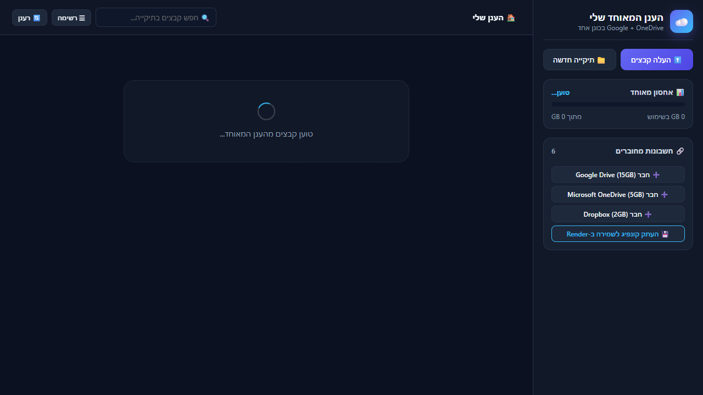

# ☁️ הענן המאוחד שלי — Unified Cloud
### איחוד כל שירותי הענן שלך למקום אחד, בחינם, 24/7

 

**[🌐 כניסה לאתר החי באוויר](https://unified-cloud.onrender.com/)** • **[📖 הוראות פריסה](DEPLOY.md)** • **[👥 צוות הפיתוח](TEAM.md)**

 

---

## ✨ על הפרויקט

**Unified Cloud** מאחד את כל חשבונות הענן שלך (גוגל דרייב, וואן דרייב, דרופבוקס, מגה ועוד) לכונן וירטואלי אחד ענק (`Union`), עם ממשק ווב מהיר ומודרני בעברית מלאה (RTL), ומאפשר גישה חלקה מכל סמארטפון, מחשב וטאבלט בעולם!

### 🎯 מה מיוחד בזה?
* 🚀 **אתר אישי אחד ויחיד** – ניהול כל הקבצים מכל הספקים בחלון דפדפן אחד.
* 🔒 **חיבור מהיר ומאובטח (Web OAuth)** – חיבור בלחיצה אחת בלי להסתבך עם קודים.
* 💻 **חיבור ישיר ככונן רשת ב-Windows (`Z:\`)** – קבצי הענן מופיעים בסייר הקבצים בדיוק כמו דיסק-און-קי מקומי דרך WinFsp!
* 🔐 **הגנה בסיסמה ובריחה מהגבלות** – כניסה מאובטחת באמצעות סיסמה פרטית והגנת Brute-Force מובנית.
* 📱 **תמיכה מלאה בסמארטפונים** – ממשק מגע מותאם, נגני וידאו ומוזיקה מובנים, ותצוגה מקדימה לתמונות ול-PDF.

---

## ☁️ ספקי הענן הנתמכים

| ספק ענן | נפח חינמי מקובל | סוג חיבור | סטטוס |
| :--- | :---: | :---: | :---: |
| **Google Drive** | 15 GB | Web OAuth 2.0 / Token | ✅ פעיל |
| **Microsoft OneDrive** | 5 GB | Microsoft Graph OAuth | ✅ פעיל |
| **Dropbox** | 2 GB | OAuth 2.0 PKCE | ✅ פעיל |
| **MEGA** | 20 GB | E2EE Credentials | ✅ פעיל |
| **Box** | 10 GB | Box OAuth 2.0 | ✅ פעיל |
| **pCloud** | 10 GB | OAuth / European API | ✅ פעיל |
| **Cloudflare R2 / S3** | 10 GB Free | S3 Access & Secret Keys | ✅ פעיל |
| **Koofr & WebDAV** | 10 GB+ | WebDAV Protocol | ✅ פעיל |
| **Yandex Disk** | 5 GB | OAuth / WebDAV | ✅ פעיל |

---

## 🚀 פריסה מהירה ל-Render בלחיצה אחת

הפרויקט בנוי לפריסה קלה בחינם ב-Render (או בכל שרת Docker):

1. העתק את ה-Repository לחשבון ה-GitHub שלך (`yehonalex-hub/unified-cloud`).
2. צור **Web Service** חדש ב-Render ובחר ב-Repository שלך.
3. הגדר שני משתני סביבה בלבד:
   * `CLOUD_PASSWORD` — הסיסמה הפרטית שלך לכניסה לאתר.
   * `RCLONE_CONFIG_BASE64` — תצורת החשבונות שלך (נוצרת אוטומטית ע"י `export-config.ps1`).
4. לחץ **Deploy** — והאתר שלך באוויר 24/7!

---

## 💻 חיבור ככונן מקומי ב-Windows (`Z:\`)

בתוך התיקייה ישנו סקריפט `mount-drive.bat`:
1. ודא שהתקנת את [WinFsp](https://winfsp.dev/).
2. הפעל בלחיצה כפולה את `mount-drive.bat`.
3. הסקריפט מסנכרן אוטומטית את ההגדרות מהענן ב-Render ומחבר את כל הענן המאוחד ככונן `Z:\` בסייר הקבצים של Windows עם מטמון מהיר!

---

## 👥 צוות הבוטים של OpenMausBot

הפרויקט מתוחזק ומפותח ע"י נבחרת בוטים אוטונומית ב-OpenMausBot:
* **MausBot:** עוזר אישי ומתאם ראשי.
* **Ziggy:** מוביל עיצוב וממשק (UI/UX).
* **Rio:** ארכיטקט אתר 1 מאוחד ונקי (Single Unified Site).
* **Luna & Pixel:** מומחי חיבורי Google Drive וחשבונות מרובים.
* **Atlas:** מומחה פריסה ל-Render ו-GitHub (DevOps).
* **Ember:** מעצב מיתוג ו-Showcase ל-GitHub.
* **Skye, Turnip & Clover:** מומחי אחסון מוצפן, WebDAV ואבטחה.

---

נוצר באהבה ❤️ עבור ענן אישי מאוחד, חופשי ופרטי.

